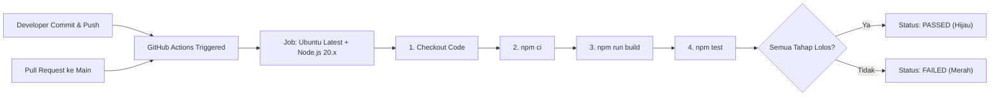

# Sistem Perpustakaan Mini - API Kelompok 7

[](https://github.com/trayyaazzahra7777-a11y/RPL-Kelompok-7-Perpustakaan-Mini/actions/workflows/ci.yml)

Repositori ini berisi implementasi **Sistem Perpustakaan Mini**, sebuah RESTful API berbasis Node.js yang dilengkapi dengan arsitektur *Continuous Integration* (CI) menggunakan GitHub Actions. Proyek ini dikembangkan oleh **Kelompok 7** untuk memenuhi tugas mata kuliah **Rekayasa Perangkat Lunak (RPL)**, Program Studi S1 Teknik Informatika, Universitas Tadulako.

---

## Identitas Kelompok 7

| No | Nama Anggota | Stambuk | Peran & Tanggung Jawab |
|:--:|:---|:---:|:---|
| 1 | **Trayya Azzahra Baso** | F5512520100 | **CI Architecture & Workflow**<br>Merancang arsitektur pipeline CI, konfigurasi GitHub Actions (`.github/workflows/ci.yml`), dan manajemen alur branch. |
| 2 | **Rahmita Nurainun R. Hambali** | F5512520083 | **Automated Testing Suite**<br>Merancang dan mengimplementasikan automated test suite menggunakan `node:test` dan `node:assert/strict`, isolasi fixture, serta verifikasi integritas data. |
| 3 | **Syifa Inayah** | F5512530104 | **Bug Simulation & Corrective Maintenance**<br>Menganalisis skenario kegagalan pipeline, pengujian regresi, dan pemeliharaan korektif (*corrective maintenance*). |
| 4 | **Safitri** | F5512530119 | **CI Documentation & Evidence**<br>Penyusunan dokumentasi proyek (`README.md`), panduan teknis, pengujian interaktif (`client.js` & Postman), dan bukti eksekusi CI. |
| 5 | **Jumiati** | F5512530120 | **Repository Management & CI Verification**<br>Manajemen repositori Git, sinkronisasi branch, verifikasi eksekusi pipeline CI, dan audit kesesuaian berkas proyek. |

- **URL Repositori GitHub**: [https://github.com/trayyaazzahra7777-a11y/RPL-Kelompok-7-Perpustakaan-Mini](https://github.com/trayyaazzahra7777-a11y/RPL-Kelompok-7-Perpustakaan-Mini)
- **Branch Utama**: `main`

---

## Deskripsi Singkat Aplikasi

Sistem Perpustakaan Mini adalah layanan backend RESTful API yang dirancang untuk mengelola data katalog buku, data keanggotaan perpustakaan, serta alur sirkulasi peminjaman dan pengembalian buku secara efisien.

Aplikasi ini memiliki karakteristik:
1. **Node.js Native**: Dibangun sepenuhnya menggunakan modul bawaan Node.js tanpa dependensi pihak ketiga (*zero external dependencies*).
2. **Integrasi Open Library Public API**: Pencarian data buku daring dan penambahan buku baru secara otomatis berdasarkan nomor ISBN dari Open Library API.
3. **Penyimpanan Berbasis File JSON**: Penyimpanan data utama disimpan pada direktori `data/` (`books.json`, `members.json`, `loans.json`).
4. **Isolasi Lingkungan Pengujian**: Mendukung variabel lingkungan `DATA_DIR` sehingga proses pengujian otomatis dijalankan pada data *fixture* tanpa memodifikasi data asli aplikasi.
5. **Klien Pengguna & Koleksi API**: Menyediakan CLI client interaktif (`client.js`) dan koleksi Postman untuk pengujian manual.

---

## Teknologi yang Digunakan

- **Runtime Environment**: [Node.js](https://nodejs.org/) (Versi 20.x pada pipeline CI)
- **Modul Bawaan Node.js**:
  - `node:http`: Penyedia web server HTTP dan penanganan request/response API.
  - `node:fs`: Operasi pembacaan dan penyimpanan berkas JSON secara sinkron.
  - `node:path`: Normalisasi dan resolusi jalur direktori lintas sistem operasi.
  - `node:crypto`: Verifikasi integritas berkas data melalui hash SHA-256.
- **Pengujian Otomatis**:
  - `node:test`: Test runner bawaan Node.js.
  - `node:assert/strict`: Pengecekan asersi tipe ketat (*strict assertion*).
- **Continuous Integration (CI)**: [GitHub Actions](https://github.com/features/actions) (`ubuntu-latest`, Node.js 20.x).
- **Public API Terintegrasi**: [Open Library API](https://openlibrary.org/).

---

## Struktur Folder Proyek

```text
PERPUSTAKAAN-MINI-CI/
├── .github/
│   └── workflows/
│       └── ci.yml               # Konfigurasi pipeline GitHub Actions (Node.js 20.x)
├── data/
│   ├── books.json               # Data utama katalog buku perpustakaan
│   ├── loans.json               # Data utama riwayat transaksi peminjaman
│   └── members.json             # Data utama keanggotaan perpustakaan
├── tests/
│   ├── fixtures/                # Data uji terisolasi untuk automated testing
│   │   ├── .gitkeep
│   │   ├── books.json
│   │   ├── loans.json
│   │   └── members.json
│   ├── .gitkeep
│   └── api.test.js              # Automated test suite (36 test cases, node:test)
├── .gitignore                   # Konfigurasi pengecualian pelacakan Git
├── client.js                    # Aplikasi klien berbasis antarmuka baris perintah (CLI)
├── package-lock.json            # Kunci versi dependensi npm
├── package.json                 # Manifes proyek, metadata, dan skrip npm
├── PANDUAN_MEMAHAMI_KODE.md     # Panduan struktur kode & materi persiapan demo
├── Perpustakaan-Mini.postman_collection.json  # Koleksi request untuk pengujian via Postman
├── README.md                    # Dokumentasi utama proyek
└── server.js                    # Implementasi REST API server HTTP native
```

---

## Persyaratan Sistem

Untuk menjalankan proyek ini secara lokal, pastikan perangkat telah terpasang:
- **Node.js**: Versi `20.x` atau versi yang lebih tinggi (rekomendasi LTS).
- **npm**: Versi `9.x` atau versi yang lebih baru (terpasang otomatis bersama Node.js).
- **Git**: Untuk manajemen versi dan kolaborasi repositori.

Periksa versi yang terpasang pada terminal:
```bash
node -v
npm -v
git --version
```

---

## Instalasi Dependensi

Proyek ini tidak memerlukan paket pihak ketiga dari npm registry karena sepenuhnya memanfaatkan modul bawaan (*native*) Node.js. Namun, untuk memastikan dependensi dan lockfile terverifikasi secara formal:

```bash
npm ci
```
*Catatan: Anda juga dapat menggunakan perintah `npm install`.*

---

## Cara Menjalankan Aplikasi

### 1. Menjalankan Server API
Jalankan server REST API dengan perintah:
```bash
npm start
```
Server akan aktif pada:
```text
http://localhost:3000
```
Untuk menghentikan server, tekan kombinasi tombol `Ctrl + C` pada terminal.

### 2. Menjalankan Klien Interaktif (CLI)
Buka jendela terminal baru saat server sedang berjalan, lalu jalankan:
```bash
node client.js
```
Klien baris perintah interaktif akan memandu pengguna untuk melihat katalog buku, menambah buku baru via ISBN, mengelola anggota, serta melakukan transaksi peminjaman dan pengembalian.

### 3. Menggunakan Postman
1. Buka aplikasi Postman.
2. Klik tombol **Import**.
3. Pilih berkas `Perpustakaan-Mini.postman_collection.json` dari repositori.
4. Seluruh endpoint katalog buku, anggota, peminjaman, serta integrasi Open Library siap diuji secara manual.

---

## Cara Menjalankan Build Check dan Automated Test

Proyek ini menyediakan skrip otomasi yang dapat dijalankan langsung melalui `npm`:

### 1. Pemeriksaan Sintaks Kode (*Build Check*)
Perintah ini melakukan verifikasi sintaksis pada berkas sumber `server.js` dan `client.js` menggunakan fitur kompilasi internal Node.js tanpa mengeksekusi proses secara penuh:
```bash
npm run build
```
Skrip yang dieksekusi:
```bash
node --check server.js client.js
```

### 2. Menjalankan Pengujian Otomatis (*Automated Testing*)
Automated test suite dijalankan menggunakan test runner native Node.js:
```bash
npm test
```
Skrip yang dieksekusi:
```bash
node --test
```

### 3. Jaminan Keamanan dan Isolasi Data Pengujian
Selama pengujian berjalan:
- Lingkungan pengujian mengatur variabel lingkungan `DATA_DIR` ke direktori `tests/fixtures/`.
- Berkas data asli pada folder `data/` (`books.json`, `loans.json`, `members.json`) terlindungi dan diverifikasi menggunakan hash SHA-256 pada asersi penutup.
- Pemanggilan eksternal Open Library di-*mock* menggunakan server HTTP lokal pada port dinamis (`port 0`), sehingga pengujian berjalan dalam hitungan milidetik, deterministik, dan dapat dijalankan tanpa koneksi internet.

### 4. Ringkasan Hasil Pengujian Terverifikasi
Pengujian mencakup **36 test cases** yang terbagi ke dalam 7 kelompok pengujian:
1. **Routing dan Error Handling (3 test)**: Endpoint 404, Method 405 dengan header `Allow`, validasi body 400.
2. **Endpoint Buku `/books` (12 test)**: `GET` semua buku, filter pencarian (`category`, `status`, `author`, `q`), `GET /:id` (200, 404, 400), `POST` buku via Open Library (201), validasi gagal (400), penolakan ISBN duplikat (409), ISBN tidak ditemukan (404), `PUT /:id` pembaruan buku (200, 400), `DELETE /:id` buku available (204), dan proteksi hapus buku pinjaman (409).
3. **Endpoint Anggota `/members` (9 test)**: `GET` daftar anggota, `GET /:id` (200, 404), `POST` anggota baru (201), validasi input (400), proteksi stambuk duplikat (409), `PUT /:id` (200, 409 jika stambuk bentrok), `DELETE /:id` (204, 409 jika anggota memiliki pinjaman aktif).
4. **Endpoint Peminjaman `/loans` (8 test)**: `GET` daftar transaksi, filter (`status`, `memberId`, `overdue`), `POST` peminjaman baru (201 & update status buku ke `borrowed`), validasi entitas 404, proteksi peminjaman ganda buku 409, `PUT /:id` pengembalian buku (200 & status buku kembali `available`), proteksi pengembalian berulang 409, validasi 404 ID pinjaman.
5. **Endpoint Pencarian Open Library `/books/search` (2 test)**: Pencarian dengan parameter `q` (200), penolakan tanpa parameter `q` (400).
6. **Verifikasi Isolasi Data (2 test)**: Integritas berkas `data/` tak berubah (hash match) dan operasi penyimpanan terbukti aktif pada `tests/fixtures/`.

Hasil eksekusi:
```text
ℹ tests 36
ℹ suites 7
ℹ pass 36
ℹ fail 0
ℹ cancelled 0
ℹ duration_ms ~386ms
```

---

## Penjelasan Workflow GitHub Actions

Workflow CI dikonfigurasikan pada berkas [`.github/workflows/ci.yml`](.github/workflows/ci.yml):

```yaml
name: CI Pipeline

on:
  push:
    branches: [ main ]
  pull_request:
    branches: [ main ]

jobs:
  test:
    name: Build & Test (Node.js 20.x)
    runs-on: ubuntu-latest

    steps:
      - name: Checkout repository
        uses: actions/checkout@v4

      - name: Setup Node.js 20.x
        uses: actions/setup-node@v4
        with:
          node-version: '20.x'

      - name: Install dependencies
        run: npm ci

      - name: Run build (syntax check)
        run: npm run build

      - name: Run automated test suite
        run: npm test
```

### Tahapan dalam Pipeline
1. **Checkout Repository (`actions/checkout@v4`)**: Mengunduh kode sumber proyek ke runner virtual Ubuntu.
2. **Setup Node.js (`actions/setup-node@v4`)**: Menyiapkan runtime environment Node.js dengan versi target `20.x`.
3. **Install Dependencies (`npm ci`)**: Memasang dependensi bersih sesuai dengan deklarasi pada `package-lock.json`.
4. **Run Build / Syntax Check (`npm run build`)**: Menjalankan pemeriksaan sintaks seluruh berkas aplikasi (`node --check server.js client.js`). Jika terdapat kesalahan sintaksis, proses CI langsung dihentikan (*fail-fast*).
5. **Run Automated Test Suite (`npm test`)**: Menjalankan seluruh pengujian (36 test cases). Jika terdapat setidaknya satu asersi yang gagal, pipeline akan berstatus merah (*failed*).

---

## Proses CI melalui Push dan Pull Request

Alur integrasi berkelanjutan (*Continuous Integration*) diterapkan dengan mekanisme:



1. **Pemicu Otomatis (*Triggers*)**:
   - Setiap kali anggota kelompok melakukan `push` perubahan ke branch `main`.
   - Setiap kali sebuah `pull_request` dibuka atau diperbarui menuju branch `main`.
2. **Pencegahan Regresi**:
   - Jika developer tanpa sengaja memasukkan galat sintaks atau merusak logika bisnis (misal: validasi ISBN, aturan pengembalian buku, atau duplikasi stambuk), automated test suite akan langsung mendeteksinya dan menggagalkan pipeline.
3. **Pemberitahuan Transparan**:
   - Status keberhasilan atau kegagalan pipeline ditampilkan secara terbuka pada tab **Actions** di repositori GitHub serta tercermin melalui badge status pada bagian atas dokumen ini.
